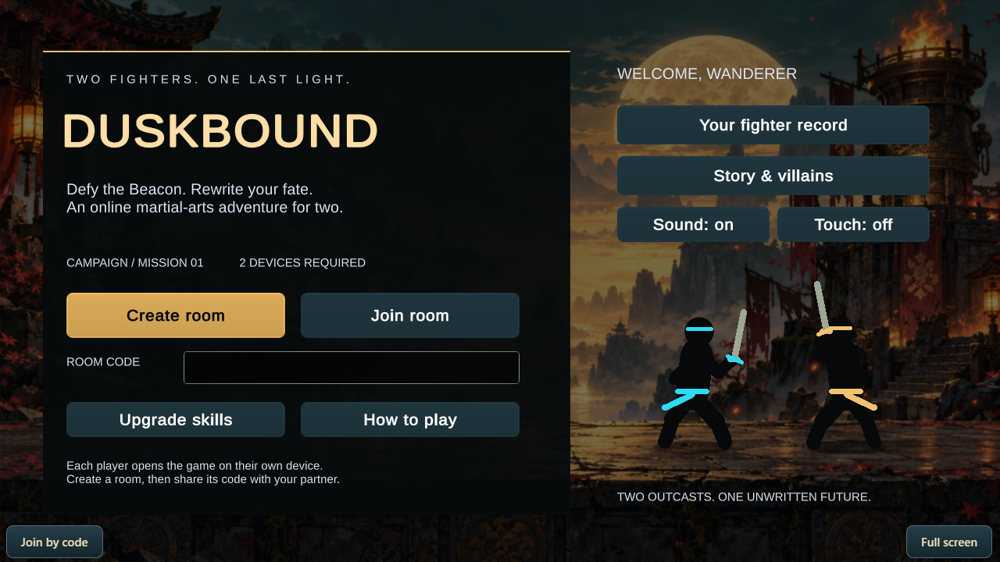

# Duskbound

Formerly Beaconbreak. An original Unity/C# two-player online co-op fighting game build. Each player uses
their own browser/device; both fight one adaptive boss. Includes friendly-fire
coordination, a generated 100-encounter campaign, progression, and boss telemetry.

This is an independently developed playable submission build, not a finished
commercial-scale game or a Nekki product. See SUBMISSION-STATUS.md for limitations.

## The story

Two former guardians desert a machine that learns from every fight and erases
those it cannot predict. Across ten chapters, confront named wardens with their
own reasons to protect the Beacon. Every victory sends your habits ahead;
cooperation is the one pattern its architect struggles to understand.

The in-game chronicle reveals motives and chapter conclusions as you progress.
The story and interface are original; this is not a copy of Shadow Fight's IP.

## Play together

1. Start Web/START-GAME.ps1 on the host PC.
2. Start Web/START-SHARING.ps1 and copy the HTTPS link it prints.
3. Open that same link on a laptop and a phone. Keep the server PC awake.
4. Player 1 selects Create Room and shares the eight-character code.
5. Player 2 selects Join by code, enters it, and presses I'M READY.
6. Turn phones sideways. Touch buttons control the phone player; laptops use
   A/D, W or Space, J, K, L and U. Both players confirm between encounters.

The HTTPS link works across different networks while the PC and tunnel remain
running. It changes when the tunnel restarts. GitHub stores source; GitHub Pages
alone cannot run this game's multiplayer WebSocket relay.

For a permanent address, deploy the Web directory as one Docker web service
with HTTPS/WebSockets and /health as its health check. The root render.yaml
provides a deployment blueprint; a hosting account is still required.

## Source and builds

- Game/: Unity 6000.6.5f1 project; install Web Build Support.
- Web/public/: current browser build, included so hosting needs no Unity license
  or editor on the server.
- Web/server.py: static hosting and two-player room relay.
- Game/TestResults/: simulation and browser test reports.
- Web/tests/: reproducible relay, multiplayer, controls and layout tests.

Open Game in Unity. Co-op Fighter > Build Web Game regenerates Web/public.
See Game/README.md and Web/README.md for architecture and hosting instructions.
Temporary logs, local environments, editor caches and old release archives are
excluded from version control.

## Compatibility and tests

Target: modern WebGL 2/WebAssembly browsers, keyboard laptops/desktops and
landscape touch devices. The arena preserves 16:9 and letterboxes wider screens;
portrait shows a rotation prompt. No promise is made for every browser/device.
Automated touch emulation is not physical iPhone/Android certification.

See Game/TestResults for measured outcomes. The host browser is authoritative;
this is private cooperative play, not a cheat-resistant competitive backend.
Progress is stored independently in each player's browser after a confirmed
victory, not a cloud account. Expedition upgrades are selected by the host and
apply to both fighters. Personal records and names are local to the device.

## Rights

All rights reserved for protectable original contributions; see LICENSE.
This is not an open-source license. Third-party rights and platform terms remain
in force. AI-assisted provenance is documented in Game/ASSETS.md.
